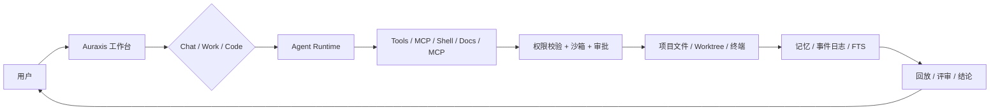
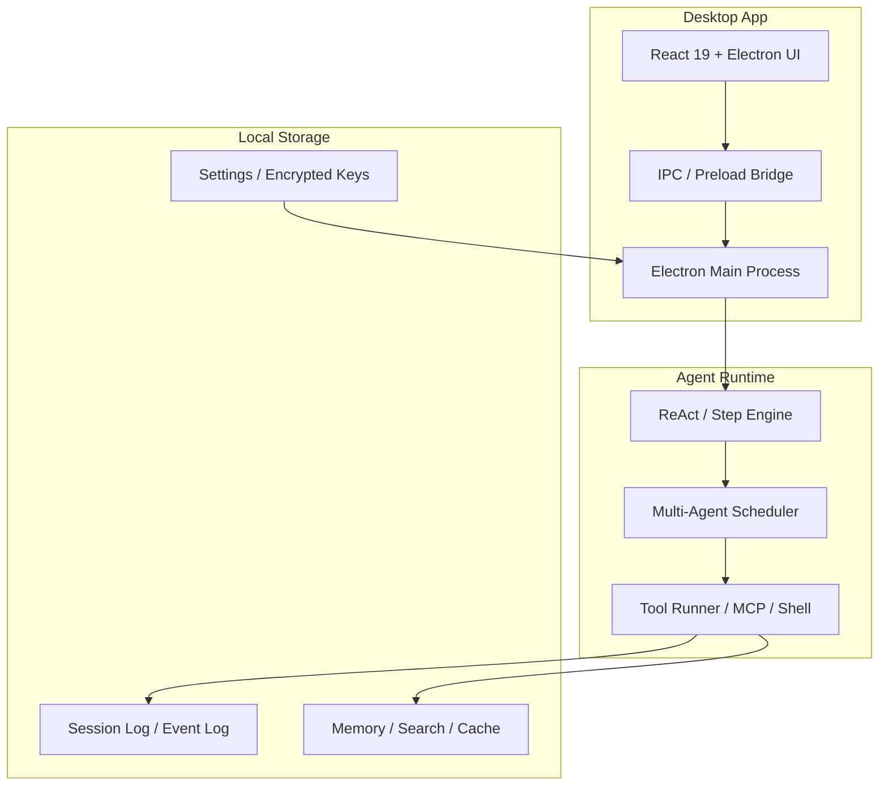

# Auraxis


Auraxis 是一个基于 Electron + React 19 + TypeScript 的桌面端 AI 智能体工作台。它把统一的 ReAct 步进引擎、多智能体调度、Code / Work 模式、MCP 连接器、文档处理能力、终端/任务编排和安全门禁结合到一体，目标是让 AI 在本地工作区中像真正的协作助手一样工作，而不是仅能在聊天框里“发散”。

从设计上，Auraxis 试图实现三件事：

- 提供一个稳定、可追踪、可审计的 Agent 执行环境
- 把“代码、文件、网页、文档、终端、任务”统一到一个工作台中
- 在不牺牲安全边界的前提下，让模型具备真实工具调用能力

## 界面预览


## 产品定位

Auraxis 不是单纯的聊天机器人，而是一个面向开发/知识工作场景的桌面工作台。它支持：

- 统一聊天、多 Agent 与 Code Mode 执行链路
- 71+ 模型工具与完整权限、审批、沙箱管线
- Chat / Work / Code 三种工作模式
- MCP、飞书/Lark、DeepSeek Harness 等连接器
- Word、Excel、PPT、PDF 文档技能
- TypeScript 与 Python 两套 SDK
- Windows / macOS / Linux 三平台构建与 E2E
- 本地账户、加密凭据、记忆与全文检索

## 功能亮点

- 统一聊天、多 Agent 与 Code Mode 执行链路
- 71+ 模型工具与完整权限、审批、沙箱管线
- Chat / Work / Code 三种工作模式
- MCP、飞书/Lark、DeepSeek Harness 等连接器
- Word、Excel、PPT、PDF 文档技能
- TypeScript 与 Python 两套 SDK
- Windows / macOS / Linux 三平台构建与 E2E
- 本地账户、加密凭据、记忆与全文检索
- 基于事件日志和会话快照的长期记忆与回放
- 计划执行、权限审批、工作树隔离与任务监控
- Agent session / workflow / feedback / eval 回归门禁

## 典型工作流

Auraxis 的使用模式可以概括为三步：

1. 让模型理解上下文和目标
2. 让模型通过工具调用在本地工作区中读取、写入、搜索、安排任务
3. 对关键动作执行审批、沙箱和审计，最终交出结果

下面是一个简化的产品时序示意：



## Mockup / 界面草图

下面是对 Auraxis 工作台的概念草图，展示它如何把聊天、工具、文件和网页页面组织起来：

```text
┌──────────────────────────────────────────────────────────────────────────┐
│ Auraxis                          [Search] [Agents] [Settings] [Profile] │
├───────────────────┬──────────────────────────────────────────────────────┤
│ Chat / Sessions   │                                                    │
│ • Session list    │  用户：请帮我检查这个仓库并修复 CI 错误                   │
│ • Agent status    │                                                    │
│ • Recent tasks    │  Agent: 我先定位失败日志 -> 搜索错误 -> 查看相关文件   │
│                   │  [tools: grep, read, run, diff]                     │
├───────────────────┼──────────────────────────────────────────────────────┤
│ Files / Worktree  │  [工具执行流 / 计划 / 审批 / 结果日志]                  │
│ • Project tree    │                                                    │
│ • Diff view       │  [Browser Preview] [Terminal] [Documents]            │
│ • Artifacts       │                                                    │
└───────────────────┴──────────────────────────────────────────────────────┘
```

### 工作模式 Mockup

| 模式 | 适合场景 | 用户感受 |
| --- | --- | --- |
| Chat | 讨论、规划、问题追踪 | 自然对话 |
| Work | 任务执行、执行计划、工作流编排 | 类似协作助手 |
| Code | 代码修复、分析和交付 | 仿真开发环境 |

## 环境要求

- Node.js `>=24`（与 Electron 44 内置的 Node 24 对齐）
- npm `>=10`
- Python `>=3.9`（仅使用 Python SDK 时需要；Windows 可用 `winget install Python.Python.3.10`）

## 快速开始

```powershell
git clone https://github.com/yth1120/Auraxis-Agent.git
cd Auraxis
npm install
Copy-Item .env.example .env
npm run electron:dev
```

首次运行前请在 `.env` 中填写 `DEEPSEEK_API_KEY`，也可以在应用设置页中配置模型密钥。

## 常用命令

| 命令 | 作用 |
| --- | --- |
| `npm run electron:dev` | 启动 Electron 开发环境 |
| `npm run electron:compile` | 编译主进程 |
| `npm run sdk:build` | 编译 TypeScript SDK |
| `npm run sdk:test` | 运行 TypeScript SDK 单元测试 |
| `npm run sdk:test:py` | 运行 Python SDK 单元测试 |
| `npm run sdk:check:py` | Python SDK 全检（ruff + pyright + 测试） |
| `npm run sdk:smoke` | 启动真实无头 runtime 并验证 SDK 连通性 |
| `npm run test` | 运行全量单元测试 |
| `npm run check` | Lint、编译、类型检查和全量测试 |
| `npm run build` | 全量构建并打包 |
| `npm run eval:agent:dry` | 评测数据集可加载性校验（无需 Key） |
| `npm run eval:agent` | 真实运行评测（需要 Key） |
| `npm run eval:diff` | 对比当前结果与冻结基线，检查回归 |

## SDK

- TypeScript：[packages/auraxis-sdk](packages/auraxis-sdk/README.md)
- Python：[python/auraxis_sdk](python/auraxis_sdk/README.md)

SDK 通过换行分隔的 JSON-RPC 2.0 协议驱动 Auraxis 无头 runtime，支持 `ping`、`agent.run` 和 `session.search`。

## 架构概览



## 安全

模型编写的任意代码执行默认关闭。工具执行必须经过权限配置、沙箱门、审批与路径边界校验；只有显式设置 `AURAXIS_ALLOW_UNSAFE_CODE=1` 的受信开发环境才允许风险操作。

项目目录内的规则文件与 hooks 默认不授权，需分别显式设置：

- `AURAXIS_TRUST_PROJECT_RULES=1`
- `AURAXIS_TRUST_PROJECT_HOOKS=1`

安全策略的核心目标是：

- 不让模型无审批地执行任意 shell 命令
- 不允许绕过本地路径限制
- 不允许滥用浏览器/webview/网页页面读取本地文件
- 对关键动作保留审计和回放能力

## 文档

- [工程规范](AGENTS.md)
- [架构与开发文档（英文）](docs/README.md)
- [架构与开发文档（中文）](docs/README.zh-CN.md)
- [评测 / 回归门禁说明](evals/README.md)
- [更新日志](CHANGELOG.md)

## 项目结构（简要）

```text
Auraxis/
├── electron/             # Electron 主进程与 Agent runtime
├── src/                  # React 19 渲染层
├── packages/auraxis-sdk  # TypeScript SDK
├── python/auraxis_sdk    # Python SDK
├── docs/                 # 架构和开发文档
├── evals/                # Agent 评测与回归测试
├── scripts/              # 构建和评测脚本
├── public/               # 静态资源
├── .env.example          # 环境变量示例
├── AGENTS.md             # 工程规范
├── CHANGELOG.md
├── LICENSE
├── README.md
└── package.json
```

## 贡献

欢迎在 Issues / Discussions 中提出问题、功能建议或改进建议。对于代码贡献建议，优先关注：

- 真实 Agent 行为质量，而不仅是 UI 表现
- 运行时的安全边界和权限设计
- 回归测试与评测稳定性
- 多平台兼容性和可维护性

## License

[MIT](LICENSE)
